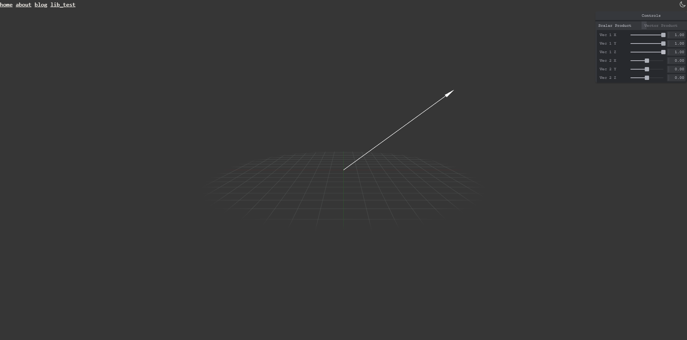

<h1 align="center">
    Project Immersion
</h1>
<h3 align="center">
    Study project: web graphics experiments with three.js / vector math / custom shaders
</h3>
<p align="center">
    Live: <a href="https://kutaycoskuner.github.io/immersion/">kutaycoskuner.github.io/immersion</a>
</p>

<p align="center">
    
    
    
    
    
    
</p>

<p align="center">
    
    <br>
    <sub><i>v0.32.0 pixel scene: light interaction on the ground and the grass</i></sub>
</p>

<p align="center">
    
    <br>
    <sub><i>v0.31.5 billboarding and alpha textures on custom shaders</i></sub>
</p>

<p align="center">
    
    <br>
    <sub><i>v0.23.0 vector control on the ui</i></sub>
</p>

<p align="center">
    
    <br>
    <sub><i>v0.22.0 drawing static vectors</i></sub>
</p>

# Installation and Use

### Prerequisites

- **Node.js 22+**: [Install Node.js](https://nodejs.org/en/download/package-manager)
- **pnpm 9** (the lock file is pnpm's): `npm install -g pnpm`

### Install and run

```bash
# 1. Clone the repository and go into it
git clone https://github.com/kutaycoskuner/immersion.git
cd immersion

# 2. Install packages
pnpm install

# 3. Start the development server: http://localhost:5173/immersion/ opens the vector page
#    (in development the site runs under /immersion, see svelte.config.js)
pnpm dev

# optional: type check, unit tests
pnpm check
pnpm test:unit --run
```

### Build

```bash
# writes the static site to build/ (relative paths, so it works from any folder)
pnpm build

# serve that build locally
pnpm preview
```

The live site is the built output, published from the `manual-deploy` branch (`docs/`).

# Pages

The top-left links switch between the pages; the bottom-left bar links to this repository, three.js and other projects, and shows the version and last update (the build date). Esc opens the settings overlay, where a `.gltf` model can be loaded into the scene.

- **vectors** (`/`): two vectors you set with the sliders of the control pane, the angle between them, and a step by step description of the product chosen in the pane's tab
    - laid out in two framed areas (faint pixel-corner frames, as in imge's matrix calculator): the description on the left, its steps in sections split by dashed lines, scrolling on its own, the viewport on the right; drag the gap between them to resize (double-click resets, the split is remembered), narrow screens stack them
    - *Scalar Product*: the dot product of the normalized vectors, drawn as the scalar projection of v1 onto v2
    - *Vector Product*: the cross product v1 x v2, drawn as a vector with the parallelogram whose area is its length
- **unfolding cube** (`/unfolding`): a cube that unfolds into its net while the mouse is over it
- **display model** (`/import_gltf`): a lit scene for a model loaded in the settings overlay
- **motion animation** (`/keyframe`): a gltf model playing its keyframe animation
- **pixel shader** (`/pixel`): low resolution render with colour quantization, depth + normal outlines, instanced grass with wind sway and a moving point light

Controls in the 3d scenes: drag to orbit, wheel to zoom, W A S D to move the camera. The viewport gizmo (bottom right, our own, Blender style) turns with the camera: click an axis to view from there (click it again for the opposite side), drag it to orbit, its button resets the view. Keys: 1 front, 3 right, 7 top, 9 opposite, . or Home reset view; on the vectors page also 5 and the gizmo button for orthographic / perspective.

# Features

- [x] svelte layouts, pages, markdown rendering
- [x] color theme
- [x] base three.js scene with a fading grid and x / z axes (custom glsl shader)
- [x] settings overlay with gltf model import
- [x] vectors with cone tips, coordinate labels and ground plane references
- [x] vector controls on the ui (tweakpane)
- [x] own viewport gizmo (axis views, drag orbit, numpad keys, reset view, orthographic switch on the vectors page), replacing the three-viewport-gizmo library
- [x] math rendering with katex (the vector descriptions, markdown)
- [x] dot product steps, angle arc between the vectors, scalar projection vector and line
- [x] cross product steps, cross product vector and its parallelogram
- [x] vector page in resizable framed areas: description (sections, own scroll, thin scrollbar) and viewport; description texts as data with inline $...$ math
- [x] version and last update (build date) in the bottom-left bar; the version comes from package.json
- [x] unfolding cube
- [x] keyframe animation test scene
- [x] pixel scene: gpu instancing with a custom shader, billboarded alpha textured grass, wind sway
- [x] pixel scene: point light interaction, ground colour passed to the grass, colour quantization
- [x] pixel scene: depth + normal screen space outlines, pixelization
- [ ] steps between the vectors: normalize, then move from vector 1 to vector 2
- [ ] markdown rendering with footnotes and toc
- [ ] json rendering
