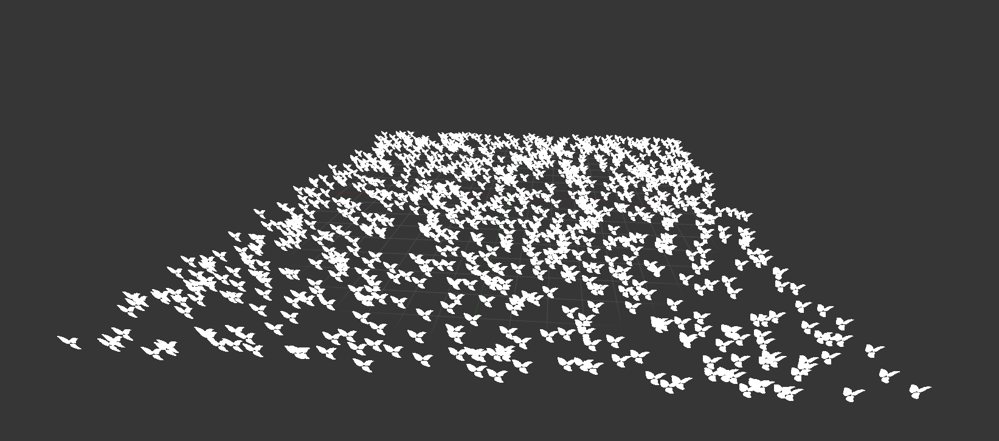
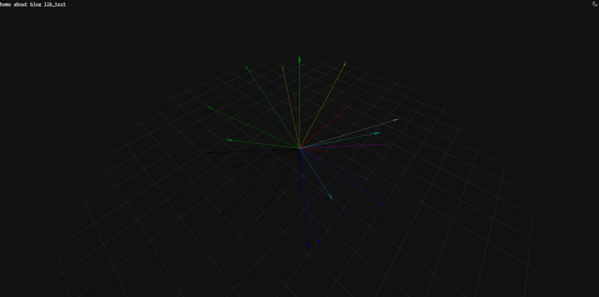

<h1 align="center">
    Project Immersion
</h1>
<h3 align="center">
    Study project: web graphics experiments with three.js / vector math / custom shaders
</h3>
<p align="center">
    Live: <a href="https://kutaycoskuner.github.io/immersion/">kutaycoskuner.github.io/immersion</a>
</p>

<p align="center">
    
    
    
    
    
    
</p>

<p align="center">
    
    <br>
    <sub><i>v0.32.0 pixel scene: light interaction on the ground and the grass</i></sub>
</p>

<p align="center">
    
    <br>
    <sub><i>v0.31.5 billboarding and alpha textures on custom shaders</i></sub>
</p>

<p align="center">
    
    <br>
    <sub><i>v0.23.0 vector control on the ui</i></sub>
</p>

<p align="center">
    
    <br>
    <sub><i>v0.22.0 drawing static vectors</i></sub>
</p>

# Installation and Use

### Prerequisites

- **Node.js 22+**: [Install Node.js](https://nodejs.org/en/download/package-manager)
- **pnpm 9** (the lock file is pnpm's): `npm install -g pnpm`

### Install and run

```bash
# 1. Clone the repository and go into it
git clone https://github.com/kutaycoskuner/immersion.git
cd immersion

# 2. Install packages
pnpm install

# 3. Start the development server: http://localhost:5173/ opens the vector page
pnpm dev

# optional: type check, unit tests
pnpm check
pnpm test:unit --run
```

### Build

```bash
# writes the static site to build/ (relative paths, so it works from any folder)
pnpm build

# serve that build locally
pnpm preview
```

More in [development](documentation/development.md): deployment, version bar, how a scene is built and cleaned up.

# Docs

- [Vectors page](documentation/vectors-page.md): dot and cross product, the Controls pane, what the viewport draws, changing the texts
- [Transformations page](documentation/transformations-page.md): translation, scaling and rotation, the switch, editable matrices, the stage bar, how M(t) works, adding a transformation
- [Viewport gizmo](documentation/viewport-gizmo.md): axis views, drag orbit, keys, orthographic switch, adding it to a scene
- [Spaces page](documentation/spaces-page.md): the steps between coordinate spaces -- 3D → 3D (local → world, the model matrix) and 3D → 2D (orthographic and perspective projection, the divide by w)
- [Origami page](documentation/origami-page.md): folding a flat sheet step by step, the model file format (points, faces, folds), drag and drop, adding a model
- [Unfolding cube page](documentation/unfolding-page.md): use, toolbar, how the cube's hinges fold, the base for origami
- [Page layout](documentation/page-layout.md): framed areas, the draggable split, descriptions as data with KaTeX, fit to width, matrices with inputs
- [Development](documentation/development.md): commands, paths and deployment, version and last update, scene lifecycle, shared state

# Pages

The top-left links switch between the pages; the bottom-left bar links to this repository, three.js and other projects and shows the version and last update. Esc opens the settings overlay, where a `.gltf` model can be loaded into the scene. In the 3d scenes: drag to orbit, wheel to zoom, the [viewport gizmo](documentation/viewport-gizmo.md) bottom right; W A S D move the camera on the vectors, display model, motion animation and pixel shader pages.

- **vectors** (`/`): two vectors and a step by step description of their dot or cross product, with the live values ([more](documentation/vectors-page.md))
- **transformations** (`/transformations`): a cube transformed by a matrix you type in, translation, scaling or rotation (Euler angles), with a 0..1 bar for the stage; each has its own link: `/transformations/translation`, `/scaling`, `/rotation` ([more](documentation/transformations-page.md))
- **spaces** (`/spaces`) (not linked in the navigation for now): the steps between coordinate spaces under the categories 3D → 3D (local → world: position, rotation, scale make the model matrix; local and world axes in the viewport) and 3D → 2D (orthographic and perspective projection, a transformation that cannot be undone); same panel and stage bar as the transformations page ([more](documentation/spaces-page.md))
- **unfolding cube** (`/unfolding`): a cube that turns by itself after 4 s without input, stops when you move, unfolds into its flat net on a click; face names and Blender-style colours as toggles; the reference for the coming origami page ([more](documentation/unfolding-page.md))
- **origami** (`/origami`) (not linked in the navigation for now): a flat sheet folded into a finished piece, step by step with a bar and play; models are JSON files, bundled ones with their own link (`/origami/dodecahedron`, `/origami/cube`) or dropped on the page ([more](documentation/origami-page.md))
- **display model** (`/import_gltf`): a lit scene for a model loaded in the settings overlay
- **motion animation** (`/keyframe`): a gltf model playing its keyframe animation
- **pixel shader** (`/pixel`): low resolution render with colour quantization, depth + normal outlines, instanced grass with wind sway and a moving point light

# Features

- [x] svelte layouts, pages, markdown rendering
- [x] color theme
- [x] base three.js scene with a fading grid and x / z axes (custom glsl shader)
- [x] settings overlay with gltf model import
- [x] vectors with cone tips, coordinate labels and ground plane references
- [x] vector controls on the ui (tweakpane)
- [x] own viewport gizmo (axis views, drag orbit, numpad keys, reset view, orthographic switch on the vectors and transformations pages), replacing the three-viewport-gizmo library
- [x] math rendering with katex (the vector descriptions, markdown)
- [x] dot product steps, angle arc between the vectors, scalar projection vector and line
- [x] cross product steps, cross product vector and its parallelogram
- [x] vector page in resizable framed areas: description (sections, own scroll, thin scrollbar) and viewport; description texts as data with inline $...$ math
- [x] version and last update (build date) in the bottom-left bar; the version comes from package.json
- [x] unfolding cube
- [x] unfolding cube reworked: full-window viewport, idle spin after 4 s (not when unfolded), click to unfold, face names and random colours as toolbar toggles
- [x] origami: fold model JSON format (points, faces, folds: line, fixed / moving, valley / mountain, angle, step), loader with checks, dodecahedron and cube, step bar with play, drag and drop of model files
- [ ] origami: flat folds through layers (paper plane)
- [x] keyframe animation test scene
- [x] pixel scene: gpu instancing with a custom shader, billboarded alpha textured grass, wind sway
- [x] pixel scene: point light interaction, ground colour passed to the grass, colour quantization
- [x] pixel scene: depth + normal screen space outlines, pixelization
- [x] transformations page: translation matrix, before / after stages, cube moved by the matrix
- [x] transformations: draggable 0..1 bar for the stage t, all values follow it
- [x] transformations: scaling, switch between translation / scaling / rotation
- [x] transformations: rotation with Euler angles (x, then y, then z), arc path
- [ ] transformations: quaternion rotation
- [x] spaces page: categories 3D → 3D (local → world) and 3D → 2D (orthographic, perspective with the divide by w)
- [ ] spaces: world → camera (view matrix), 2D → 2D (viewport)
- [x] hand gizmo model: simple low-poly right hand, flat colours with one outline, fingers along the axes in the axis colours
- [x] gizmo: hand button (hand instead of the axes), R / L for right- and left-handed axes
- [ ] steps between the vectors: normalize, then move from vector 1 to vector 2
- [ ] markdown rendering with footnotes and toc
- [ ] json rendering
